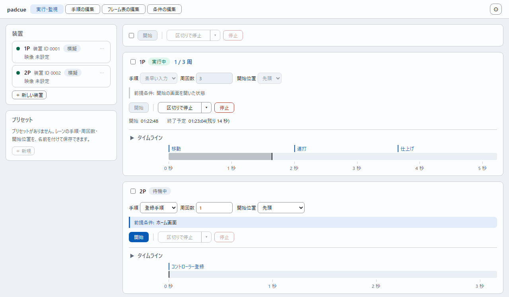
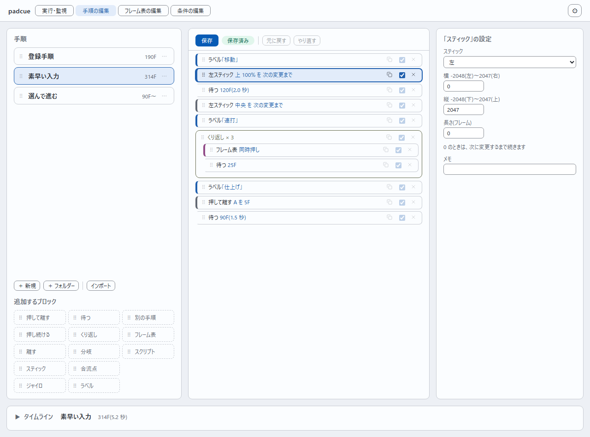

# padcue

Nintendo Switch 2 を自動で操作するツールです。PC で作った手順のとおりに、装置(M5Stack AtomS3 Lite)が Switch 2 の有線コントローラーとして入力を送ります。

- 入力の時刻は装置のタイマーが決めるので、PC の処理や Wi-Fi の通信が遅れても、入力どうしの間隔は変わりません。ただし、PC が選ぶ分岐、グループで待ち合わせる合流点、スクリプトのブロックでは、PC からの指示を受け取るまで止まって待ちます
- 手順は 1 フレーム(約 1/60 秒)単位で書きます。くり返し、分岐、別の手順の呼び出しが使えます
- 手順の作成と実行は、ブラウザーで開く操作画面で行います。PC 側は Python の標準ライブラリだけで動きます。映像機器(OBS の仮想カメラ、キャプチャーボード)から映像を取るときだけ、ffmpeg を使います
- PC に取り込んだゲームの映像を見て、分岐の選択肢を自動で選べます
- 複数の装置を同時に動かせます。台数に上限はありませんが、実機で動作を確認しているのは 2 台のグループまでです。一緒に開始した装置はグループになり、手順の中の合流点で待ち合わせます。1 台が完了や異常で停止すると、残りも停止します。画面ではグループ全体のほか、1 台ずつも停止できます
- 初代 Switch でも動きます

導入は [docs/getting-started.md](docs/getting-started.md)、日常の使い方は [docs/runbook.md](docs/runbook.md)、用語は [docs/glossary.md](docs/glossary.md) にあります。



装置ごとの操作欄(レーン)で、手順と周回数と開始位置を選んで実行します。タイムラインは進み具合を示し、開くと何フレーム目に何を押すかがそのまま出ます。

---

## 必要なもの

| 必要なもの | 条件と用途 |
|---|---|
| PC | Windows。Python 3.11 以上と、ブラウザー(Chrome / Edge など) |
| 装置 | M5Stack AtomS3 Lite。同時に動かす Switch の台数ぶん。購入先の例: [スイッチサイエンス](https://www.switch-science.com/) |
| ケーブル | データ通信できる USB ケーブル(Type-A と Type-C)を装置ごとに 1 本。通常は装置とドックをつなぎ、PC につなぐのは最初の書き込みのときだけです |
| Wi-Fi | 装置がつながる 2.4GHz の Wi-Fi。PC と装置を同じ LAN に置きます |
| Switch | 本体と純正ドック。本体設定で Pro コントローラーの有線通信を ON にします |
| esptool | 任意です。コマンドで書き込むときだけ使います(getting-started.md §1-2)。操作画面から書き込むときは必要ありません。`python -m pip install esptool` で入れます |
| ffmpeg | 映像機器(OBS の仮想カメラ、キャプチャーボード)を映像ソースに使うときに必要です。`winget install Gyan.FFmpeg` などで入れます。デスクトップ・ウィンドウ・画像ファイルには必要ありません |
| numpy と OpenCV | 任意ですが、映像で選択肢を選ぶなら入れてください。入っていないと、1 回の判定に数秒かかることがあり、短い間だけ出る画面を見逃すことがあります。入れても判定の結果は変わりません。`python -m pip install numpy opencv-python` で入れます。速さの違いは [observe-and-decide.md](docs/specs/observe-and-decide.md) の「設計判断」にあります |

実機がなくても、模擬装置を使って、手順の作成と実行、画面の操作を試せます。

---

## 入手

```powershell
git clone https://github.com/eoforgu0/padcue.git
cd padcue
```

git を使わない場合は、このページの「Code」から「Download ZIP」を選んで取得し、展開してください。

---

## 試す

`padcue-demo.bat` をダブルクリックすると、模擬装置 2 台とサンプルの手順が入ったデモの操作画面が開きます。作ったものは `demo\` フォルダーに保存するので、実機用の登録情報と手順は変わりません。

レーンの「手順」で「サンプル」を選び、タイムラインを開いて入力を確認し、「開始」を押します。手順の作成と編集も同じ画面で行います。終わるときは、`padcue-demo.bat` が開いたウィンドウで Ctrl+C を押します。

実機で使うときは `padcue.bat` を開きます。手順やフレーム表などのデータは、`padcue.bat` と同じフォルダーの `data\` に保存されます(手順は `data\procedures\`、フレーム表は `data\frametables\`)。装置へのファームウェアの書き込み、Wi-Fi の設定、Switch との接続は、[docs/getting-started.md](docs/getting-started.md) の順に進めてください。

コマンドからも使えます。よく使うコマンドは [docs/runbook.md の「コマンド一覧」](docs/runbook.md#コマンド一覧)にあり、すべてのコマンドは `python -m padcue --help` で見られます。次の例はデモの模擬装置を操作するので、デモを開いたまま、別の PowerShell で padcue のフォルダーに移ってから実行します。

```powershell
$env:PYTHONPATH = "pctool"
python -m padcue --project demo status                          # 1 台目の装置の状態
python -m padcue --project demo --device 1P run サンプル -n 3 -w  # 3 周実行して進捗を表示(Ctrl+C で装置も停止)
```

---

## 使う前に

- オフラインとローカルの用途に限ってください。オンライン対戦やランキングでの使用は利用規約に反する可能性があり、アカウント停止を含む結果は利用者の責任です
- 装置の制御ポートに**認証はありません**(同じ LAN の誰でも操作できます)。信頼できる家庭内ネットワークでだけ使い、インターネットに露出させないでください
- 装置は、Switch にとって追加のコントローラーです。普段使っているコントローラーもつないでいると、1 人分のコントローラーだけを使うゲームでは、装置の入力が反映されないことがあります。そのときは、HOME メニューの「コントローラー」>「持ちかた/順番を変える」の画面で、装置から L と R を押して、装置をゲームで使うコントローラーにします([docs/getting-started.md の 3-3](docs/getting-started.md#3-3-ゲームで装置の入力が反映されないとき))
- 停止したいときは、装置の上面のボタンを **1.5 秒長押し** します。全入力を離して実行と手動操作を停止し、操作権を手放します
- 手順の「スクリプト」ブロックと、選択肢の選択条件「スクリプトの結果」は、PC 上で **任意のコマンドを実行**します。条件の映像ソースに画像ファイルを指定すると、そのパスのファイルを読みます。手順と条件は、ほかの人から受け取って使うこともできますが、信頼できるものだけを動かしてください(詳細は [SECURITY.md](SECURITY.md))

---

## 手順の書き方

通常は操作画面で作ります。



左のブロックを置いていくと手順になります。くり返し、分岐、フレーム表の呼び出しもブロックです。以下はその保存形式です。JSON と CSV のテキストなので、git で差分を読め、エディターやほかのツールで直接書き換えられます。

保存するファイルは 2 種類です。手順の流れは JSON で、密な同時入力はフレーム表として CSV で書きます。CSV は 1 行が 1 フレームです。

`procedures/サンプル.json`: 流れ

```json
{
  "kind": "procedure",
  "format": 1,
  "precondition": "ボタンの動作チェックの画面を開いた状態",
  "body": [
    {"type": "label", "id": "lb-1", "name": "開始"},
    {"type": "press", "buttons": ["DR"], "frames": 5},
    {"type": "wait", "frames": 60},
    {"type": "loop", "id": "lp-1", "count": 3, "body": [
      {"type": "frametable", "ref": "サンプル"},
      {"type": "wait", "frames": 30}
    ]},
    {"type": "label", "id": "lb-2", "name": "終了"},
    {"type": "wait", "frames": 60}
  ]
}
```

`frametables/サンプル.csv`: フレーム表(DL と DR は十字キーの左と右)

```csv
F,DL,DR
1,1,
2,1,
3,1,
4,,
5,,1
6,,1
7,,1
8,,
```

### 書くときの決まり

- スティックは、中心を 0 とする -2048〜+2047 の整数で書きます(左と下が負)。ジャイロ(GY / GR / GP)と加速度(AX / AY / AZ)も整数で、どれも書いた値をそのまま Switch へ送ります。ジャイロの軸と符号は [docs/runbook.md の 1-7](docs/runbook.md#1-7-ジャイロについて) にあります
- CSV の空のセルは「離す」か 0 です(加速度の AZ だけは静止した姿勢の 4096)。列そのものがない入力も同じで、フレーム表は何も押さないことも含めて表のとおりに入力します
- くり返しの各回は、くり返しに入る直前の入力の状態から始まります。くり返しの間ずっと押しておくボタンは、くり返しの前で押します
- 気づきにくい書き方には、編集している間に警告が出ます(同じフレームで押して離していて入力が現れない、一定のジャイロが長く続く、など)。長さが 1 フレームの入力はゲームに読まれないことがあり、編集画面がその場で知らせます

詳細は [docs/specs/file-format.md](docs/specs/file-format.md)。

---

## 構成

```text
docs/           設計と仕様の文書
firmware/       装置側(ESP-IDF)
  components/pademu_core/   移植できる C(手順の解釈と実行、コントローラーとしての応答)
  main/                     ESP32 固有(USB・タイマー・通信・保存・状態の管理)
pctool/         PC 側(Python。手順の変換・通信・コマンド・操作画面・模擬装置)
```

文書の一覧と選び方は [docs/README.md](docs/README.md) にあります。

---

## 開発

開発にだけ使うものを入れます(使うだけなら必要ありません)。

```powershell
python -m pip install -e "./pctool[dev]"   # pytest・ruff・playwright
python -m playwright install chromium      # 画面を実際に動かすテストに使う
```

テストの実行、ツールの使い方、ファームウェアのビルド(ESP-IDF v6.1)は [CONTRIBUTING.md](CONTRIBUTING.md) にあります。テストはどれも実機なしで通ります。

- バージョンごとの変更は [CHANGELOG.md](CHANGELOG.md)
- 安全上の前提は [SECURITY.md](SECURITY.md)

---

## 商標

このプロジェクトは任天堂株式会社とは関係がなく、公認も後援も受けていません。「Nintendo Switch」等は同社の商標で、対象機器を指すためだけに使っています(詳細は [NOTICE](NOTICE))。

---

## ライセンス

[Apache License 2.0](LICENSE)。

ただし純正コントローラーから採取した HID レポートディスクリプター 203 バイトなど、第三者に権利がある要素が含まれます。扱いは [NOTICE](NOTICE) を参照してください。
